

  <picture>
    <source media="(max-width: 600px)" srcset="https://raw.githubusercontent.com/prx-my/prx-my/main/profile-assets/titles/status-mobile.svg">
    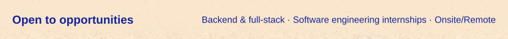
  </picture>

  <picture>
    <source media="(prefers-reduced-motion: no-preference)" srcset="https://raw.githubusercontent.com/prx-my/prx-my/main/profile-assets/prxmy-risograph.gif">
    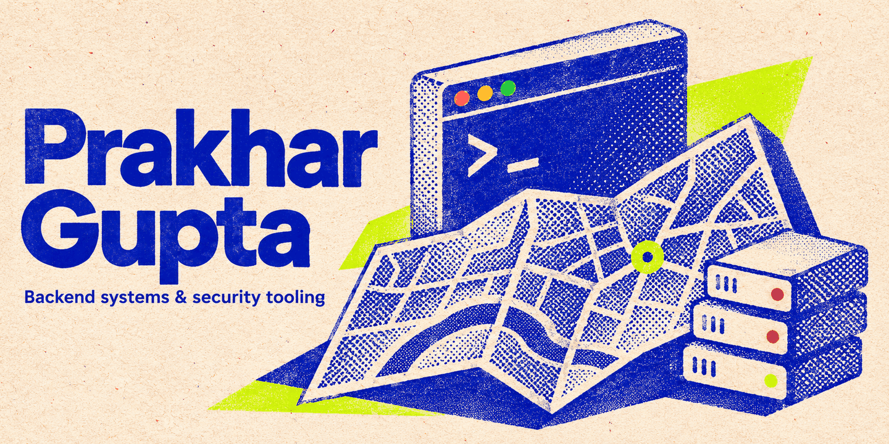
  </picture>

  <a href="https://github.com/prx-my#contributions"><picture><source media="(max-width: 600px)" srcset="https://raw.githubusercontent.com/prx-my/prx-my/main/profile-assets/metrics/streak-mobile.svg">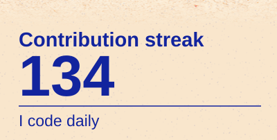</picture></a><a href="https://github.com/OWASP/cve-lite-cli/pull/1202"><picture><source media="(max-width: 600px)" srcset="https://raw.githubusercontent.com/prx-my/prx-my/main/profile-assets/metrics/featured-fix-mobile.svg">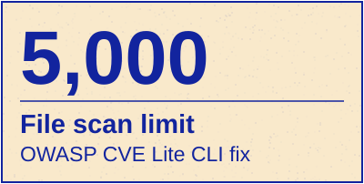</picture></a><a href="https://github.com/search?q=is%3Apr+is%3Amerged+author%3Aprx-my&amp;type=pullrequests"><picture><source media="(max-width: 600px)" srcset="https://raw.githubusercontent.com/prx-my/prx-my/main/profile-assets/metrics/merged-mobile.svg">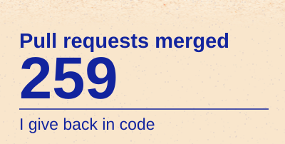</picture></a>

  <picture>
    <source media="(max-width: 600px)" srcset="https://raw.githubusercontent.com/prx-my/prx-my/main/profile-assets/titles/work-mobile.svg">
    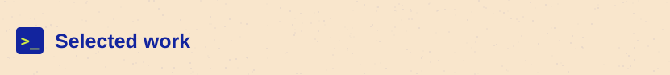
  </picture>

  <a href="https://github.com/OWASP/cve-lite-cli/pull/1202"><picture>
    <source media="(max-width: 600px)" srcset="https://raw.githubusercontent.com/prx-my/prx-my/main/profile-assets/work/owasp-mobile.svg">
    
  </picture></a>
  <a href="https://github.com/AWS-env/environmental-hacks"><picture>
    <source media="(max-width: 600px)" srcset="https://raw.githubusercontent.com/prx-my/prx-my/main/profile-assets/work/ecoaudit-mobile.svg">
    
  </picture></a>
  <a href="https://youtu.be/JvkJd1MAV3M"><picture>
    <source media="(max-width: 600px)" srcset="https://raw.githubusercontent.com/prx-my/prx-my/main/profile-assets/work/jansamadhan-mobile.svg">
    
  </picture></a>
  <a href="https://github.com/AWS-env/sarthi"><picture>
    <source media="(max-width: 600px)" srcset="https://raw.githubusercontent.com/prx-my/prx-my/main/profile-assets/work/sarthi-mobile.svg">
    
  </picture></a>
  <a href="https://github.com/prx-my/railmind"><picture>
    <source media="(max-width: 600px)" srcset="https://raw.githubusercontent.com/prx-my/prx-my/main/profile-assets/work/railmind-mobile.svg">
    
  </picture></a>

  <picture>
    <source media="(max-width: 600px)" srcset="https://raw.githubusercontent.com/prx-my/prx-my/main/profile-assets/titles/open-source-mobile.svg">
    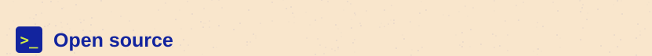
  </picture>

  <a href="open-source/owasp.md">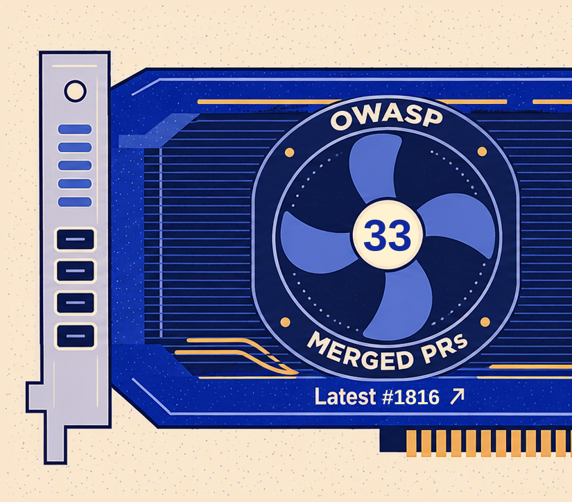</a><a href="open-source/sugar-labs.md">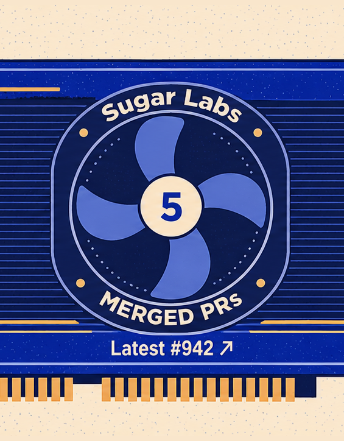</a><a href="open-source/ecoaudit.md">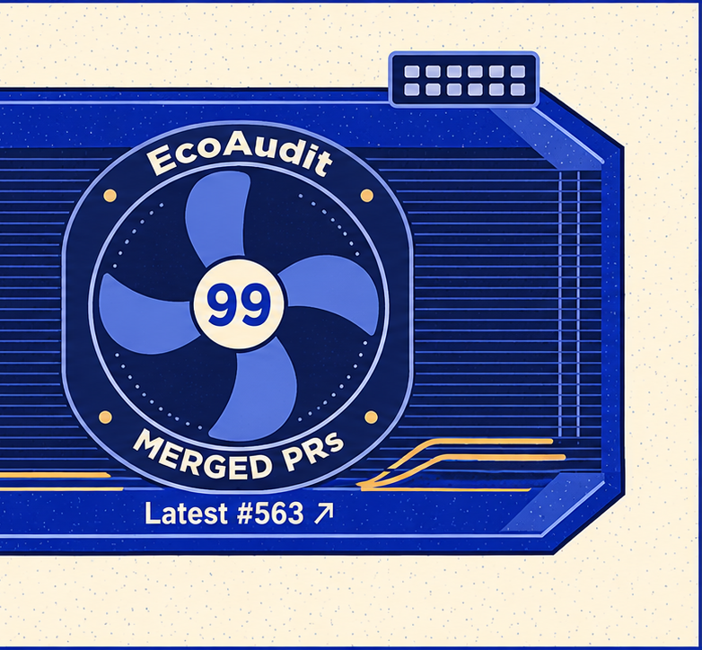</a>

  <picture>
    <source media="(max-width: 600px)" srcset="https://raw.githubusercontent.com/prx-my/prx-my/main/profile-assets/titles/stack-mobile.svg">
    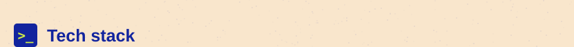
  </picture>

  <picture>
    <source media="(max-width: 600px)" srcset="https://raw.githubusercontent.com/prx-my/prx-my/main/profile-assets/stack/processor-mobile.svg">
    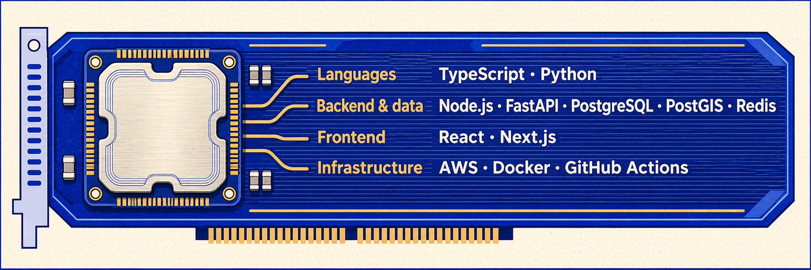
  </picture>

  <picture>
    <source media="(max-width: 600px)" srcset="https://raw.githubusercontent.com/prx-my/prx-my/main/profile-assets/titles/activity-mobile.svg">
    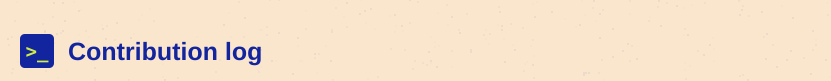
  </picture>

  <a href="https://github.com/prx-my#contributions">
    <picture>
      <source media="(max-width: 600px)" srcset="https://raw.githubusercontent.com/prx-my/prx-my/main/profile-assets/activity-mobile.svg">
      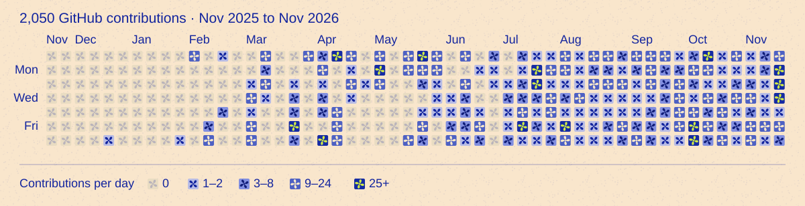
    </picture>
  </a>

  <picture>
    <source media="(max-width: 600px)" srcset="https://raw.githubusercontent.com/prx-my/prx-my/main/profile-assets/titles/contact-mobile.svg">
    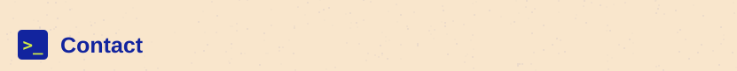
  </picture>

  <a href="https://prxmy.in/">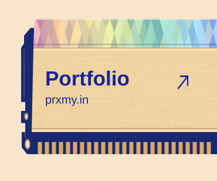</a><a href="https://x.com/_prxmy">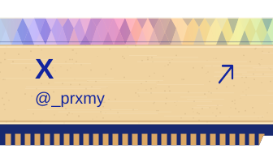</a><a href="https://www.linkedin.com/in/prxmy/">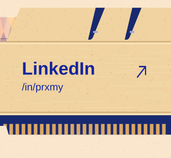</a>

