<!-- Generated by `python scripts/console/fetch.py && python scripts/console/render.py && python scripts/console/readme.py`. -->

<picture><source media="(prefers-color-scheme: light)" srcset="https://github.com/prx-my/prx-my/raw/main/assets/light/header.svg"></picture>
<picture><source media="(prefers-color-scheme: light)" srcset="https://github.com/prx-my/prx-my/raw/main/assets/light/links.svg"></picture>
<a href="https://prxmy.in"><picture><source media="(prefers-color-scheme: light)" srcset="https://github.com/prx-my/prx-my/raw/main/assets/light/links/globe.svg"></picture></a><a href="https://www.linkedin.com/in/prxmy/"><picture><source media="(prefers-color-scheme: light)" srcset="https://github.com/prx-my/prx-my/raw/main/assets/light/links/linkedin.svg"></picture></a><a href="https://x.com/_prxmy"><picture><source media="(prefers-color-scheme: light)" srcset="https://github.com/prx-my/prx-my/raw/main/assets/light/links/x.svg"></picture></a><a href="mailto:Prakhar06.work@gmail.com"><picture><source media="(prefers-color-scheme: light)" srcset="https://github.com/prx-my/prx-my/raw/main/assets/light/links/mail.svg"></picture></a>
<picture><source media="(prefers-color-scheme: light)" srcset="https://github.com/prx-my/prx-my/raw/main/assets/light/stats.svg"></picture>
<picture><source media="(prefers-color-scheme: light)" srcset="https://github.com/prx-my/prx-my/raw/main/assets/light/contribution-city.svg"></picture>
<picture><source media="(prefers-color-scheme: light)" srcset="https://github.com/prx-my/prx-my/raw/main/assets/light/projects.svg"></picture>
<a href="https://github.com/AWS-env/bhumi-vikas-sahayak"><picture><source media="(prefers-color-scheme: light)" srcset="https://github.com/prx-my/prx-my/raw/main/assets/light/card-bhumi.svg"></picture></a><a href="https://github.com/AWS-env/environmental-hacks"><picture><source media="(prefers-color-scheme: light)" srcset="https://github.com/prx-my/prx-my/raw/main/assets/light/card-ecoaudit.svg"></picture></a><a href="https://github.com/OWASP/cve-lite-cli/pulls?q=is%3Apr+author%3Aprx-my+is%3Amerged"><picture><source media="(prefers-color-scheme: light)" srcset="https://github.com/prx-my/prx-my/raw/main/assets/light/card-owasp.svg"></picture></a><a href="https://github.com/sugarlabs/musicblocks-v4/pulls?q=is%3Apr+author%3Aprx-my+is%3Amerged"><picture><source media="(prefers-color-scheme: light)" srcset="https://github.com/prx-my/prx-my/raw/main/assets/light/card-sugar.svg"></picture></a>
<a href="https://github.com/OWASP/cve-lite-cli/pull/1202"><picture><source media="(prefers-color-scheme: light)" srcset="https://github.com/prx-my/prx-my/raw/main/assets/light/quote.svg"></picture></a>
<picture><source media="(prefers-color-scheme: light)" srcset="https://github.com/prx-my/prx-my/raw/main/assets/light/merged.svg"></picture>
<a href="https://github.com/OWASP/cve-lite-cli/pull/1372"><picture><source media="(prefers-color-scheme: light)" srcset="https://github.com/prx-my/prx-my/raw/main/assets/light/merged/1.svg"></picture></a>
<a href="https://github.com/OWASP/cve-lite-cli/pull/1371"><picture><source media="(prefers-color-scheme: light)" srcset="https://github.com/prx-my/prx-my/raw/main/assets/light/merged/2.svg"></picture></a>
<a href="https://github.com/OWASP/cve-lite-cli/pull/1370"><picture><source media="(prefers-color-scheme: light)" srcset="https://github.com/prx-my/prx-my/raw/main/assets/light/merged/3.svg"></picture></a>
<a href="https://github.com/OWASP/cve-lite-cli/pull/1369"><picture><source media="(prefers-color-scheme: light)" srcset="https://github.com/prx-my/prx-my/raw/main/assets/light/merged/4.svg"></picture></a>
<a href="https://github.com/OWASP/cve-lite-cli/pull/1366"><picture><source media="(prefers-color-scheme: light)" srcset="https://github.com/prx-my/prx-my/raw/main/assets/light/merged/5.svg"></picture></a>
<a href="https://github.com/OWASP/cve-lite-cli/pulls?q=is%3Apr+author%3Aprx-my+is%3Amerged"><picture><source media="(prefers-color-scheme: light)" srcset="https://github.com/prx-my/prx-my/raw/main/assets/light/merged/owasp.svg"></picture></a><a href="https://github.com/sugarlabs/musicblocks-v4/pulls?q=is%3Apr+author%3Aprx-my+is%3Amerged"><picture><source media="(prefers-color-scheme: light)" srcset="https://github.com/prx-my/prx-my/raw/main/assets/light/merged/sugar.svg"></picture></a>
<picture><source media="(prefers-color-scheme: light)" srcset="https://github.com/prx-my/prx-my/raw/main/assets/light/milestones.svg"></picture>
<picture><source media="(prefers-color-scheme: light)" srcset="https://github.com/prx-my/prx-my/raw/main/assets/light/stack.svg"></picture>
<picture><source media="(prefers-color-scheme: light)" srcset="https://github.com/prx-my/prx-my/raw/main/assets/light/footer.svg"></picture>

