# Prakhar Gupta

**Backend & security tooling in TypeScript and Python. Open to software engineering internships (any term), actively looking.**

I look for the places where a dev tool says "all clear" but isn't.

<!-- PROOF:START -->
Selected fixes (13 in [OWASP cve-lite-cli](https://github.com/OWASP/cve-lite-cli), 5 in [Sugar Labs musicblocks-v4](https://github.com/sugarlabs/musicblocks-v4)):

- [#1202](https://github.com/OWASP/cve-lite-cli/pull/1202) A repo past 5,000 files could scan green with an empty report; a truncated scan is now distinguishable from a clean one, findings survive `--only-used`, and the cut is disclosed.
- [#1231](https://github.com/OWASP/cve-lite-cli/pull/1231) Compact mode showed 3 of 54 findings and called the plan complete; both finding and command-group truncation are now disclosed.
- [#1183](https://github.com/OWASP/cve-lite-cli/pull/1183) Fixed npm's `0.x` caret semantics in the semver oracle that decides which override versions a CVE report admits.
<!-- PROOF:END -->

3x hackathon winner: 1st Place LeafLine (NSUT Avinya '26) · Claude Impact Labs Bhopal '26 · India Innovate '26

  
  
  
  
  

 

## Things I've Built

Real tools, shipped and used. The hard parts aren't CRUD.

| Project | The hard part | Stack |
|---|---|---|
| **[Bhumi Vikas Sahayak](https://github.com/AWS-env/bhumi-vikas-sahayak)** | Answers building-permission questions from the 108-page MP Bhumi Vikas Rules by grounding every reply in the exact rule number, rule text, and PDF page, in English, Hindi, or Hinglish, and saying so when the rules are silent. Ships a Next.js web app and an Apple Watch client. | `Python` · `Next.js` · `Swift` |
| **[Ecoaudit](https://github.com/AWS-env/environmental-hacks)** | Audits source and config for compute-waste patterns (repeated queries, serial I/O, oversized builds) **without executing the code**, then cites evidence with a detection confidence and keeps static findings separate from any carbon-savings claim. | `Python` · `TypeScript` · `AWS CDK` |

 

## Open Source Contributions

Merged work in real projects: reviewed, tested, and shipped upstream.

<!-- CONTRIBUTIONS:START -->

  

 

### Sugar Labs · [musicblocks-v4](https://github.com/sugarlabs/musicblocks-v4)
Blocks-based music programming environment · TypeScript · React · Zustand

| PR | Change | Area |
|:--:|---|---|
| [#942](https://github.com/sugarlabs/musicblocks-v4/pull/942) | Share the drag trailing-click suppression guard across three call sites | `refactor` · `masonry` |
| [#919](https://github.com/sugarlabs/musicblocks-v4/pull/919) | Clear and toggle brick selection on press | `fix` · `masonry` |
| [#871](https://github.com/sugarlabs/musicblocks-v4/pull/871) | Separate drag and click selection so drags stop leaving bricks selected | `fix` · `masonry` |
| [#850](https://github.com/sugarlabs/musicblocks-v4/pull/850) | Duplicate a brick and its subtree as an independent tower | `feat` · `masonry` |
| [#646](https://github.com/sugarlabs/musicblocks-v4/pull/646) | Correct tail step width bleed for `strokeWidth > 2` | `fix` · `geometry` |
<!-- CONTRIBUTIONS:END -->

 

## Activity

  

  

  

  

 

##  Tech Stack

  

 

##  Let's Connect

  
  
  
  

