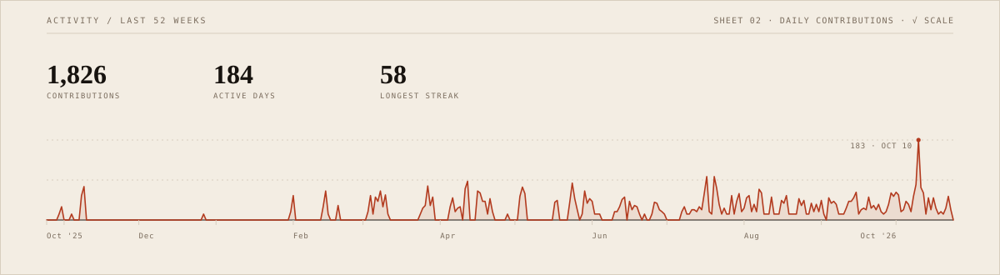

  <picture>
    <source media="(max-width: 640px)" srcset="assets/hero-phone.svg">
    
  </picture>

<!-- PROOF:START -->
Selected fixes (13 in [OWASP cve-lite-cli](https://github.com/OWASP/cve-lite-cli), 5 in [Sugar Labs musicblocks-v4](https://github.com/sugarlabs/musicblocks-v4)):

- [#1202](https://github.com/OWASP/cve-lite-cli/pull/1202) A repo past 5,000 files could scan green with an empty report; a truncated scan is now distinguishable from a clean one, findings survive `--only-used`, and the cut is disclosed.
- [#1231](https://github.com/OWASP/cve-lite-cli/pull/1231) Compact mode showed 3 of 54 findings and called the plan complete; both finding and command-group truncation are now disclosed.
- [#1183](https://github.com/OWASP/cve-lite-cli/pull/1183) Fixed npm's `0.x` caret semantics in the semver oracle that decides which override versions a CVE report admits.
<!-- PROOF:END -->

  <a href="https://prxmy.in">prxmy.in</a> &nbsp;·&nbsp; <a href="https://linkedin.com/in/prxmy">LinkedIn</a> &nbsp;·&nbsp; <a href="https://x.com/_prxmy">X</a> &nbsp;·&nbsp; <a href="mailto:Prakhar06.work@gmail.com">Email</a>

  1st Place LeafLine (NSUT Avinya '26) · Claude Impact Labs '26 · India Innovate '26

 

## Things I've Built

Real tools, shipped and used. The hard parts aren't CRUD.

| Project | The hard part | Stack |
|---|---|---|
| **[Bhumi Vikas Sahayak](https://github.com/AWS-env/bhumi-vikas-sahayak)** | Answers building-permission questions from the 108-page MP Bhumi Vikas Rules by grounding every reply in the exact rule number, rule text, and PDF page, in English, Hindi, or Hinglish, and saying so when the rules are silent. Ships a Next.js web app and an Apple Watch client. | `Python` · `Next.js` · `Swift` |
| **[Ecoaudit](https://github.com/AWS-env/environmental-hacks)** | Audits source and config for compute-waste patterns (repeated queries, serial I/O, oversized builds) **without executing the code**, then cites evidence with a detection confidence and keeps static findings separate from any carbon-savings claim. | `Python` · `TypeScript` · `AWS CDK` |

 

## Open Source Contributions

Merged work in real projects: reviewed, tested, and shipped upstream.

<!-- CONTRIBUTIONS:START -->

  
  &nbsp;
  

 

### Sugar Labs · [musicblocks-v4](https://github.com/sugarlabs/musicblocks-v4)
Blocks-based music programming environment · TypeScript · React · Zustand

| PR | Change | Area |
|:--:|---|---|
| [#942](https://github.com/sugarlabs/musicblocks-v4/pull/942) | Share the drag trailing-click suppression guard across three call sites | `refactor` · `masonry` |
| [#919](https://github.com/sugarlabs/musicblocks-v4/pull/919) | Clear and toggle brick selection on press | `fix` · `masonry` |
| [#871](https://github.com/sugarlabs/musicblocks-v4/pull/871) | Separate drag and click selection so drags stop leaving bricks selected | `fix` · `masonry` |
| [#850](https://github.com/sugarlabs/musicblocks-v4/pull/850) | Duplicate a brick and its subtree as an independent tower | `feat` · `masonry` |
| [#646](https://github.com/sugarlabs/musicblocks-v4/pull/646) | Correct tail step width bleed for `strokeWidth > 2` | `fix` · `geometry` |

 

### OWASP · [cve-lite-cli](https://github.com/OWASP/cve-lite-cli)
Dependency CVE scanner &amp; override-hygiene CLI · TypeScript · Node.js

**Impact highlights**

- [#1202](https://github.com/OWASP/cve-lite-cli/pull/1202) - **Surface the 5000-file scan cap so `--only-used` can't drop findings**: A repo past the 5,000-file usage cap could scan green with an empty SARIF report. Findings now survive, --fail-on still gates, and the truncation is disclosed.
- [#1231](https://github.com/OWASP/cve-lite-cli/pull/1231) - **Disclose compact-mode finding and command-group truncation**: Compact mode was showing 3 of 109 findings and calling the plan complete. Both withheld findings and command groups are now disclosed.
- [#1183](https://github.com/OWASP/cve-lite-cli/pull/1183) - **Apply the `0.x` caret rule in `satisfiesRange`**: Corrected npm's 0.x caret semantics in satisfiesRange, which decides which versions an override admits and feeds OA010.
- [#1271](https://github.com/OWASP/cve-lite-cli/pull/1271) - **Emit HTML override fix commands relative to the scanned project**: HTML fix commands were relative to the process cwd, so they did not run. They now resolve against the scanned project.

| PR | Change | Area |
|:--:|---|---|
| ★ [#1202](https://github.com/OWASP/cve-lite-cli/pull/1202) | Surface the 5000-file scan cap so `--only-used` can't drop findings | `fix` · `security` |
| ★ [#1231](https://github.com/OWASP/cve-lite-cli/pull/1231) | Disclose compact-mode finding and command-group truncation | `fix` · `output` |
| ★ [#1183](https://github.com/OWASP/cve-lite-cli/pull/1183) | Apply the `0.x` caret rule in `satisfiesRange` | `fix` · `semver` |
| ★ [#1271](https://github.com/OWASP/cve-lite-cli/pull/1271) | Emit HTML override fix commands relative to the scanned project | `fix` · `report` |
| [#1284](https://github.com/OWASP/cve-lite-cli/pull/1284) | replace the trailing positional parameters with an options object | `refactor` · `sarif` |
| [#1285](https://github.com/OWASP/cve-lite-cli/pull/1285) | replace em dashes in source and output strings | `chore` |
| [#1269](https://github.com/OWASP/cve-lite-cli/pull/1269) | cover positionAgainstRange's MAX_SAFE_INTEGER boundary | `test` · `version` |
| [#1273](https://github.com/OWASP/cve-lite-cli/pull/1273) | Ignore `.claude/` so the rule travels with the repo | `fix` · `gitignore` |
| [#1229](https://github.com/OWASP/cve-lite-cli/pull/1229) | De-duplicate flag-conflict error messages | `refactor` · `cli` |
| [#1228](https://github.com/OWASP/cve-lite-cli/pull/1228) | Add braces to remaining single-line `if` statements | `style` · `cli` |
| [#1230](https://github.com/OWASP/cve-lite-cli/pull/1230) | Extract CLI flag literals into named constants | `refactor` · `cli` |
| [#1181](https://github.com/OWASP/cve-lite-cli/pull/1181) | Correct OA008 pluralization and order copies by version | `fix` · `overrides` |
| [#1200](https://github.com/OWASP/cve-lite-cli/pull/1200) | Document the OA010 override-hygiene rule | `docs` · `rules` |
<!-- CONTRIBUTIONS:END -->

 

## Activity

  <picture>
    <source media="(max-width: 640px)" srcset="assets/activity-phone.svg">
    
  </picture>

 

##  Tech Stack

  

 

##  Let's Connect

  <a href="https://prxmy.in">Portfolio</a> &nbsp;·&nbsp; <a href="https://www.linkedin.com/in/prxmy/">LinkedIn</a> &nbsp;·&nbsp; <a href="https://x.com/_prxmy">X</a> &nbsp;·&nbsp; <a href="mailto:Prakhar06.work@gmail.com">Email</a>

